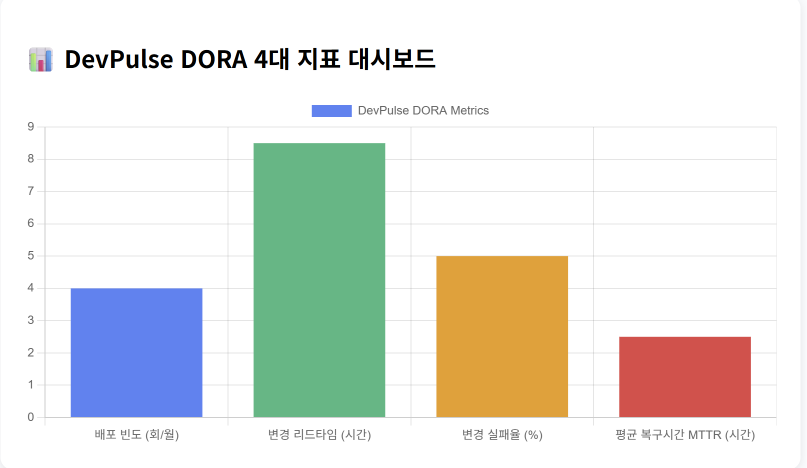

# DevPulse

GitHub 활동 데이터 기반 팀 프로젝트 진척도 시각화 및 코드 리뷰 보조 플랫폼

## DORA Metrics Dashboard

## Core Features
- **PR Size Analyzer (`src/prSizeAnalyzer.js`)**: 변경 라인 수 기반 PR 크기(`Small` / `Medium` / `Large`) 자동 분류
- **Commit Validator (`src/commitValidator.js`)**: Conventional Commits 규칙 준수 여부 정규식 검증
- **Safe JSON Sanitizer (`src/jsonSanitizer.js`)**: Windows UTF-8 BOM 제거 및 예외 처리 파싱
- **Automated CI/CD (`.github/workflows/ci-cd.yml`)**: Ubuntu/Windows × Node 18/20 Matrix 테스트, Composite Action, Artifact 업로드 및 변경 감지 선택적 배포

## Documentation & Governance
- **Stage 13 LLM Persona Feedback, 2-Week A/B Test & Persevere Decision**: [docs/STAGE13_EXPERIMENT_AND_DECISION.md](docs/STAGE13_EXPERIMENT_AND_DECISION.md)
- **Testing, TDD 5 Features, Legacy Refactoring & Playwright E2E Report**: [docs/STAGE12_TESTING_TDD_E2E.md](docs/STAGE12_TESTING_TDD_E2E.md)
- **Feature Flags, A/B Test & Canary Rollout Report**: [docs/STAGE11_FLAGS_AB_CANARY.md](docs/STAGE11_FLAGS_AB_CANARY.md)
- **Contributing & Branch Strategy**: [CONTRIBUTING.md](CONTRIBUTING.md)
- **Code Review Guidelines**: [docs/REVIEW_GUIDE.md](docs/REVIEW_GUIDE.md)
- **Architecture Decision Records**: [docs/adr/001-zero-dependency-dora-collector.md](docs/adr/001-zero-dependency-dora-collector.md)
- **Sprint Metrics Analysis**: [docs/SPRINT_ANALYTICS.md](docs/SPRINT_ANALYTICS.md)
- **OSS License & Inner Source Roadmap**: [docs/OSS_AND_INNERSOURCE.md](docs/OSS_AND_INNERSOURCE.md)
- **Project Retrospective**: [docs/RETROSPECTIVE.md](docs/RETROSPECTIVE.md)
- **Code of Conduct & Security**: [CODE_OF_CONDUCT.md](CODE_OF_CONDUCT.md) | [SECURITY.md](SECURITY.md)

## Live Deployment & Cloud Strategy
- **Live Frontend (GitHub Pages)**: https://rkdtks1446-ui.github.io/devpulse/
- **Docker & Cloud Deployment Strategy**: [docs/DOCKER_CLOUD_DEPLOYMENT_STRATEGY.md](docs/DOCKER_CLOUD_DEPLOYMENT_STRATEGY.md)
- **Cloud Container IaC**: [Dockerfile](Dockerfile) | [docker-compose.yml](docker-compose.yml) | [render.yaml](render.yaml)
